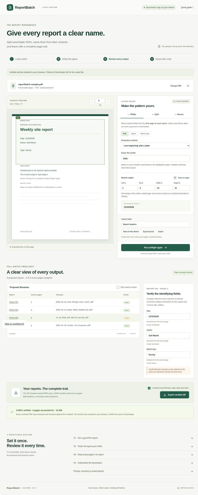

<div align="center">

# ReportBatch

### Give every report a clear name.

Split searchable PDFs, name reports from their contents, and keep a complete page trail.

**Local-first · MIT licensed · No account · No paid API**

[Quick start](#quick-start) · [How it works](#how-it-works) · [Limits & safety](#limits--safety) · [Validation](#validation) · [Contributing](#contributing)

</div>

> **Release candidate, v0.1.0.** Core workflows have been tested with synthetic documents. Production acceptance is still pending runtime privacy, cold offline-browser, browser-memory and broader accessibility checks. See the [release checklist](docs/RELEASE-CHECKLIST.md).

<p align="center">
  
  <br /><sub>Real application screenshot using fictional sample reports.</sub>
</p>

## Why ReportBatch?

For recurring batches where each report follows the same layout: define the identifying fields once, inspect every proposed output, and export named PDFs with evidence of where every page went.

PDF splitting and region-based naming already exist in other tools. ReportBatch focuses on a small, inspectable open-source workflow: **explicit rules, blocking checks, operator corrections and an auditable manifest**. It does not claim unique capabilities or guaranteed extraction accuracy.

| Define | Review | Export |
| --- | --- | --- |
| Draw field regions or enter coordinates. Match an exact prefix or one complete line. | Check filenames and page ranges beside the source preview. Resolve missing, ambiguous or clipped values. | Download named PDFs plus `manifest.json`, with source pages, field evidence and SHA-256 checksums. |
| Save versioned layouts locally or as JSON. | Duplicate filenames block export. Rule and correction changes invalidate approval. | Every generated PDF is reopened before and after ZIP creation. |

## Quick start

Requires **Node.js 22.13+** and npm.

```sh
git clone https://github.com/hardw00t/reportbatch.git
cd reportbatch
npm ci
npm run build
npm run serve
```

Open **http://127.0.0.1:4173**. Stop the server with Ctrl+C. The included server binds to loopback and serves static files; PDF processing runs in the browser. Dependency installation needs internet access. For development, use `npm run dev`.

### First good export

1. Choose **Try the sample** to load four fictional reports and matching rules.
2. Run **full-batch preflight**. Review each filename, page range and notice.
3. Select a report to compare its fields with the source. Enter verified corrections if needed, then recheck.
4. Confirm your review and **Export verified ZIP**. Check your browser's Downloads list and inspect the PDFs before sharing them.

For multipage reports, use [the grouped sample](public/samples/grouped-reports.pdf) and **Exact start-marker line** with `REPORT START`. The expected ranges are **1–2, 3, 4–6**. A repeated header can create incorrect boundaries, so review every range.

## How it works

- **Searchable, fixed-layout PDFs.** Required fields come from each report's first page. No OCR, AI inference or locale-based date conversion.
- **Two grouping modes.** One page per report, or an exact whole-line start marker within a chosen region. Marker mode requires a match on page 1; it does not infer boundaries when a value changes.
- **Literal, predictable names.** Templates support field keys plus `{index}` and `{page}`. Unsafe filename characters are replaced; duplicate names block rather than receive silent suffixes.
- **Reusable layouts.** Explicitly saved rules use browser `localStorage`. Export/import schema-versioned JSON presets; up to eight required fields.
- **Review before export.** Missing, ambiguous and clipped values require correction. Cancellation stops the worker; rerun preflight to recover. The original PDF is never written.

Dates remain text: `12/10/2026` becomes `12_10_2026` only because `/` cannot be used in a filename.

## Offline package

```sh
npm run package:offline
```

This creates `release/reportbatch-offline.zip` and its SHA-256 file. Extract the complete archive on a machine with Node.js 22.13+ already installed:

```sh
node verify.mjs
node serve.mjs
```

No npm installation is needed on the consuming machine. The archive includes the app, PDF assets, license notices, loopback server and integrity inventory. Use localhost; opening `index.html` with `file://` is unsupported.

Package integrity and server startup are tested. **A cold, network-disconnected browser workflow remains unverified.** Checksums detect changed files; they do not authenticate the publisher.

## Limits & safety

| Input or output | Current bound |
| --- | --- |
| Source | 1–500 pages; at most 30 MiB |
| Extracted text | 2 million characters total; 6,000 items per page |
| Visible page dimensions | 30–10,000 pt per axis |
| Generated PDFs | 200 MiB combined, before ZIP/manifest overhead |
| Filename | 180 UTF-8 bytes including `.pdf` |
| Preset | Schema 1; 64 KiB; 1–8 fields; 20 locally saved layouts |

These are safety limits, not a promise that every PDF within them works. Unsupported: scans or blank/no-text pages, encrypted files, vertical writing, forms, signatures, annotations, attachments, portfolios, layers and document actions. Bookmarks and document-level structure are not preserved.

**Splitting is not redaction or sanitization.** Shared resources can retain non-visible content. Do not use split PDFs as a confidentiality boundary for untrusted documents. Counts and checksums do not prove semantic accuracy or arbitrary-document visual fidelity.

### Privacy and recovery

The application has no document-upload endpoint, telemetry or account. PDF bytes and extracted text are processed in memory; only explicitly saved layout rules persist automatically. A hosted copy still receives ordinary asset requests and connection metadata. Runtime network/storage verification remains an open acceptance gate.

The manifest intentionally contains source filenames, field values, corrections and lineage. Protect it like the PDFs. Clearing the document releases application references; it is not secure erasure of browser/OS memory or downloads. If a download fails, check Downloads and retry; the app cannot confirm disk persistence.

Read the [threat model](docs/THREAT-MODEL.md) and [release runbook](docs/RELEASE-RUNBOOK.md) before relying on outputs.

## Validation

**Recorded evidence:** 35 Node tests and production build pass. Live synthetic checks cover presets, grouped reports, Unicode, rotated/cropped and mixed-size output, clipping rejection/recovery, 500-report export and cancellation, exact size/page boundaries, keyboard flows and zoom. Downloaded PDFs are independently reopened and checked against their manifests.

**Still open:** runtime request/storage and hosted-header inspection, cold offline-browser execution, browser-memory measurement, broader accessibility/mobile coverage. Manual browser checks do not mean the automated browser suite passed.

```sh
npm test                 # Rules, real PDFs, server and packaging
npm run build            # Typecheck, assets and production CSP checks
npm run test:e2e          # Browser workflow, accessibility and privacy checks
npm run test:perf         # Separate browser performance/boundary suite
npm run fixtures         # Regenerate synthetic PDFs
npm run licenses         # Dependency/license inventory
```

Browser tests require installed Chrome, or Playwright Chromium with `PW_CHANNEL=chromium`. Build first. See [current evidence](docs/RELEASE-CHECKLIST.md), [final live regressions](docs/FINAL-LIVE-REGRESSION.md) and [remaining gates](docs/NEXT-VALIDATION.md) for exact coverage and limitations.

## Contributing

Small, reproducible fixes are welcome. Include a **synthetic** failing fixture, expected behavior and regression test. Run tests and build; describe browser/platform coverage honestly. Never attach confidential PDFs, credentials or customer data to an issue or pull request.

Keep the scope focused: fixed-layout searchable PDFs, explicit review and traceable outputs. Please discuss substantial features before implementing them. There is no paywall or paid-feature tier.

- `src/core/` — extraction, rules, planning and PDF verification
- `src/engine.worker.ts` — batch processing and cancellation
- `src/App.tsx` — layout and review workflow
- `tests/` — core, PDF and browser regressions
- `scripts/` — fixtures, local serving and offline packaging

## License

[MIT](LICENSE). Dependency metadata and license review are recorded in [DEPENDENCIES.json](docs/DEPENDENCIES.json) and [DEPENDENCY-REVIEW.md](docs/DEPENDENCY-REVIEW.md). Distribution builds include upstream notices and asset licenses. The synthetic Unicode fixture uses Noto Sans under the SIL Open Font License.
